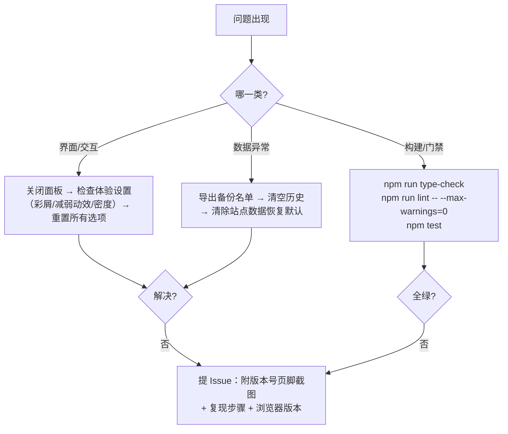

# ZenDraw | 禅抽 · 常见问题（FAQ）与故障排除

> 适用版本：v5.7.14 ｜ 最后更新：2026-11-25 ｜ 维护人：WorkBuddy（AI 助手）

## 目录

1. [使用类问题](#1-使用类问题)
2. [数据类问题](#2-数据类问题)
3. [部署开发类问题](#3-部署开发类问题)
4. [故障排除流程](#4-故障排除流程)

## 1. 使用类问题

**Q1：按空格键没有反应？**
`Space` 快捷键在以下情况不生效（设计使然，防止误触）：光标在输入框/文本域内、焦点在某个按钮上、设置面板已开启。先按 `Escape` 关闭面板、点击页面空白处让焦点离开输入控件，再按 `Space`。

**Q2：抽取动画太慢/太快？**
设置面板 →「抽取设置」→ 时长滑条（1–30 秒，默认 5 秒）。滚动中再点一次按钮（或按 `Space`）可提前停止并立即出结果。

**Q3：如何让结果带编号格式（如 `NO.007`）？**
设置面板 →「外观」→ 补零位数设为 3、前缀输入 `NO.`。右侧有实时格式预览。

**Q4：彩屑/动画影响观感，如何关闭？**
设置面板 →「体验」→ 关闭「结果彩屑」；若对动效整体敏感，开启**「减弱动效」**——界面动画减弱、彩屑完全不渲染（系统开启「减弱动态效果」时也会自动生效）。

**Q5：界面太挤/太松？**
设置面板 →「体验」→ 密度切换「舒适 / 紧凑」。

**Q6：如何换成英文界面？**
两处入口：顶部语言切换按钮，或设置面板 →「外观」→ 语言（中文/English）。当前支持简体中文（默认）与英文两种语言。

## 2. 数据类问题

**Q7：刷新页面后设置还在吗？**
在。全部 19 项设置与历史记录持久化在浏览器 localStorage，刷新/重启浏览器均保留。

**Q8：历史记录会无限增长吗？**
不会，最多保留**最近 100 条**，超出自动淘汰最旧的。

**Q9：换浏览器/换电脑后数据没了？**
数据只存在原浏览器本地，不跨设备同步（无服务端）。重要名单请在设置面板用**导出**功能备份为文本。

**Q10：清空浏览器数据会有什么影响？**
站点数据清除后，19 项设置与历史全部恢复默认。应用本身无 Cookie、无埋点。

**Q11：读取到损坏的数据会白屏吗？**
不会。历史与名单等键读取时带类型守卫，损坏数据回退默认值。

## 3. 部署开发类问题

**Q12：`npm run build` 失败，提示清理 `.next/standalone` 需要确认？**
本机环境的已知红线（任务 L3）：`.next` 内残留中断构建的 standalone（约 1300+ 文件），构建清理触发安全删除防护。**不要尝试脚本化批量删除**；替代方案：① 用全新临时 distDir 构建验证；② 交由 CI（GitHub Actions Node 22）验证；③ 用户自行在终端清理后重建。

**Q13：本机 Node 26 下测试失败（localStorage）？**
v5.7.13 起已在 `app/test/setup.ts` 内置 polyfill，69 个用例可全部通过。若仍失败请确认依赖已重装（`npm install`）。

**Q14：CI 用什么 Node 版本？**
GitHub Actions 两个 job 均为 **Node 22**。本地 ≥ 18.18 均可运行（见 Node 版本策略说明 [optimization.md O2](optimization.md)）。

**Q15：页脚显示的 build 编号每次构建都变？**
设计如此：编号为构建时刻的 10 位时间戳 `yymmddhhmm`，由 `next.config.ts` 构建期注入；开发模式为 dev server 启动时刻。缺失时页脚回退为仅显示版本号。

**Q16：部署到子路径/rootDir 后图标 404？**
若以子目录方式部署（如 EdgeOne `rootDir:app`），Next 不服务仓库根 `public/`，`/favicon.svg` 等会 404——需将 public 资源纳入该 rootDir 或调整部署结构（详见 [deployment.md §4.4](deployment.md#44-平台部署vercel--edgeone-等)）。

**Q17：有没有 API 可以集成？**
没有。本项目无任何 HTTP API（详见 [api.md §1](api.md#1-关于-openapi本项目不适用)）。

## 4. 故障排除流程

提 Issue 时请附：页脚版本标识（`V主.次.修 · build 编号`）、浏览器与版本、复现步骤、控制台报错。诊断约定见 [SPEC §8.3](../openspec/SPEC.md)（安全头）。
