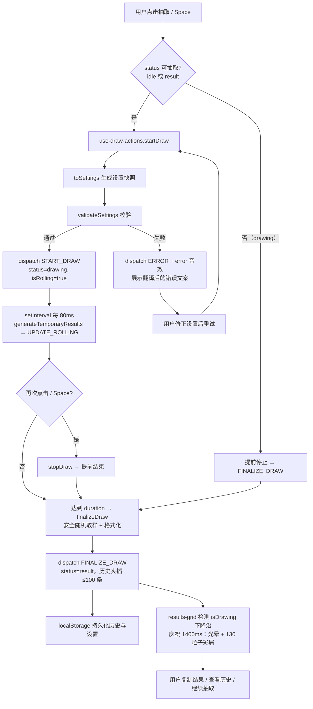
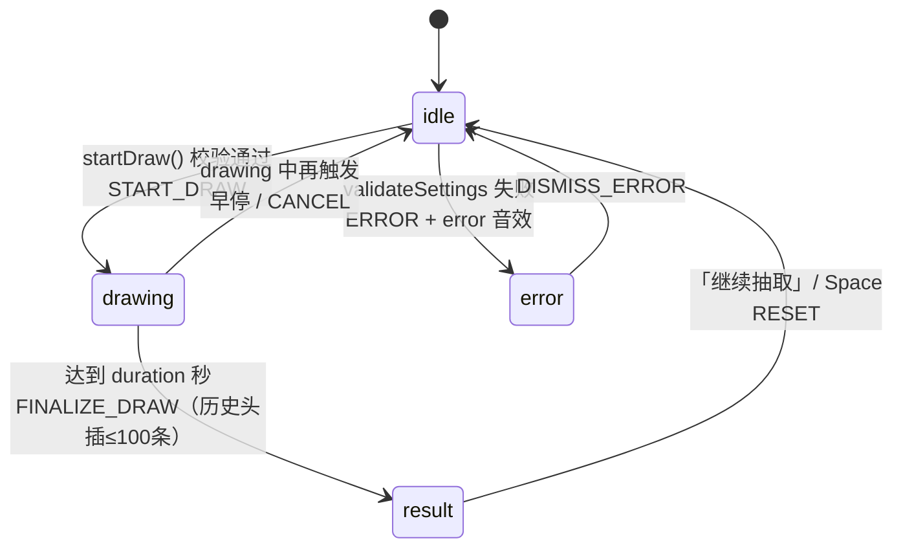

# ZenDraw | 禅抽 · 功能模块说明

> 适用版本：v5.7.14 ｜ 最后更新：2026-11-25 ｜ 维护人：WorkBuddy（AI 助手）
> 术语遵循 SPEC §0.4（「抽取」不称「抽奖」；「设置面板（Sheet）」不称「侧边栏/抽屉」）。

## 目录

1. [模块总览](#1-模块总览)
2. [抽取引擎](#2-抽取引擎)
3. [设置面板（4 Tab）](#3-设置面板4-tab)
4. [历史记录](#4-历史记录)
5. [主题与外观系统](#5-主题与外观系统)
6. [国际化](#6-国际化)
7. [音效与彩屑](#7-音效与彩屑)
8. [无障碍支持](#8-无障碍支持)

## 1. 模块总览

| 模块 | 入口组件/模块 | 职责 |
|---|---|---|
| 抽取引擎 | `hooks/use-draw.ts` + `draw-reducer.ts` + `use-draw-actions.ts` | 状态机、校验、滚动动画、结果生成 |
| 设置面板 | `components/draw/settings-panel/` | 4 Tab：抽取 / 外观 / 体验 / 历史 |
| 历史记录 | `components/draw/history-list/` | 最近 100 条、复制、清空 |
| 主题外观 | `components/theme-provider.tsx` | light/dark/system + 11 配色 + 3 字体 |
| 国际化 | `lib/i18n.ts` + `locales/` | zh/en 双语，110 键编译期保证 |
| 音效彩屑 | Web Audio + `confetti-burst.tsx` | 抽取音效链 + canvas 粒子 |
| 持久化 | `hooks/use-local-storage.ts` + `use-draw-persistence.ts` | 19 个 `zendraw-*` 键 |

### 1.1 业务全流程（跨模块）

**关键边界**：校验失败不进入滚动态；名单模式与数字模式共享同一状态机，仅取样来源不同；历史写入与 UI 揭晓同步发生，刷新后由 localStorage 恢复。

## 2. 抽取引擎

**状态机**：`DrawStatus = "idle" | "drawing" | "result" | "error"`（`draw-types.ts`），由 `draw-reducer.ts` 集中转移。

**关键逻辑**：

- **校验**（`draw-helpers.ts validateSettings`）：范围跨度 ≤ `LIMITS.MAX_RANGE`（10,000,000）、数量 ≤ `MAX_COUNT`（1000）、名单 ≤ `MAX_LIST_ITEMS`（1000）、时长 ≤ `MAX_DURATION`（30s）、补零 ≤ `MAX_DIGITS`（20）；失败进入 error 态并播 error 音效；
- **滚动动画**：`window.setInterval` 每 80ms（`TICK_MS`）dispatch `UPDATE_ROLLING` 更新临时值，每 3 tick 播 tick 音效；总时长 `Math.max(1000, duration×1000)` ms；timer 存 `animationRef` 并在卸载/停止时清理；
- **结果生成**（`finalizeDraw`）：名单模式随机取样（受 `allowDuplicates` 控制），数字模式 `secureRandomInt`（crypto.getRandomValues 封装，非 `Math.random`）；结果经 `formatNumber` 施加补零/前缀/后缀；
- **显示优先级**：`rollingValues.length ? rollingValues : currentResults`（滚动中显示临时值）；
- **庆祝触发**（`results-grid.tsx`）：监听 `isDrawing` true→false 上升沿，`setCelebrating(true)` 1400ms → 光晕 + 彩屑；会话第 1 次与每 10 次抽取显示里程碑徽章。

## 3. 设置面板（4 Tab）

`settings-panel/index.tsx`，默认打开「抽取设置」Tab，面板宽 420px，`Escape` 关闭。

| Tab | 组件 | 设置项（默认值 / 持久化键） |
|---|---|---|
| 抽取设置 | `draw-settings.tsx` | 最小值（1 / `zendraw-min`）、最大值（100 / `zendraw-max`）、数量滑条 1–100（1 / `zendraw-count`）、时长滑条 1–30s（5 / `zendraw-duration`）、允许重复（true / `zendraw-duplicates`）、启用名单（false / `zendraw-use-custom`）+ 名单内联编辑（`zendraw-custom-list`） |
| 外观 | `appearance-settings.tsx` | 主题模式 light/dark/system（next-themes）、配色预设 11 选 1（default / `zendraw-theme-preset`）、字体 3 选 1（sans / `zendraw-font-family`）、语言 zh/en（zh / `zendraw-language`）、补零 0–20（3 / `zendraw-digits`）、前缀（`zendraw-prefix`）、后缀（`zendraw-suffix`）+ 实时格式预览 |
| 体验 | `experience-settings.tsx` | 音效（true / `zendraw-sound`）、彩屑（true / `zendraw-confetti`）、减弱动效（false / `zendraw-reduce-motion`）、自动隐藏面板（true / `zendraw-autohide`）、密度 comfortable/compact（`zendraw-density`）、重置所有选项（保留语言） |
| 历史 | 复用 `HistoryList` | 见 §4 |

**单一登记处**：全部 16 个设置字段由 `draw-types.ts` 的 `SETTINGS_FIELDS` 常量登记，`toSettings`/`initialSettings`/快照均由其派生，`settings-fields.test.ts` 含编译期穷尽守卫。

## 4. 历史记录

- **结构**：`HistoryEntry { id: crypto.randomUUID(); timestamp: ISO; results: string[] }`；
- **上限**：100 条（`FINALIZE_DRAW` 头插后 `slice(0, 100)`；reducer 测试含 120 次抽取断言 length===100）；
- **操作**：单条点击复制（`navigator.clipboard` + toast 提示）；一键清空（`CLEAR_HISTORY`）；暂无批量导出（见 [optimization.md O6](optimization.md)）；
- **读取容错**：`zendraw-history` 读取带类型守卫，脏数据回退空数组而非白屏。

## 5. 主题与外观系统

- **模式**：light / dark / system，由 `next-themes` 管理（不占 `zendraw-*` 键）；
- **配色预设 11 个**：default（默认）、ocean 海洋蓝、forest 森林绿、sunset 落日橙、purple 紫罗兰、neon 霓虹、sakura 樱花粉、midnight 午夜蓝、retro 复古棕、pixel 像素风、rose 玫瑰红——根元素 class 切换 CSS 变量（`default` 走 `:root`，其余 10 个为独立覆盖类）；
- **字体 3 种**：sans / mono / serif（`FONT_FAMILIES`）；
- 持久化键 2 个：`zendraw-theme-preset`、`zendraw-font-family`。

## 6. 国际化

- **语言**：`"zh" | "en"` 两种，简体中文为默认；**繁体中文未提供**，补齐方案见 [optimization.md O1](optimization.md)；
- **键完整性编译期保证**：`types.ts` 的 `TranslationKey` union × `Record<TranslationKey, string>` 字典，zh/en 任一缺键/多键即编译失败；当前 110 键；
- **回退**：非法 `zendraw-language` 值回退 `zh`（`use-stored-language.test.ts` 覆盖）；
- **切换 UI**：设置面板外观 Tab 语言按钮 + HeaderBar 语言切换按钮（`Languages` 图标）。

## 7. 音效与彩屑

- **音效链**（`use-sound.ts`，Web Audio 合成，无音频资源文件）：start（开始）→ tick（每 3 tick）→ result（揭晓）/ error（校验失败）；受 `zendraw-sound` 开关控制；
- **彩屑**（`confetti-burst.tsx`）：自研 canvas 2D 粒子——130 粒子、8 色盘、重力 0.28、requestAnimationFrame 循环、devicePixelRatio 缩放（上限 2）、RAF 自清理防泄漏；受 `zendraw-confetti` 控制；
- **减弱动效三层支持**：① 系统偏好（`useMountedReducedMotion`，useSyncExternalStore 防 hydration 不匹配）② 用户设置 `zendraw-reduce-motion`（任一开启即减弱）③ 减弱时彩屑组件直接 return null、动效 duration 置 0。

## 8. 无障碍支持

- **语义化 id**（kebab-case）：`app-shell`（role="application"）、`app-main`、`draw-area`、`action-area`、`history-area`、`app-footer`、`app-footer-version`、`history-list`、`results-region`、`result-cards-grid`、`tab-panel-draw` 等；
- **aria**：结果区 `aria-live="assertive"`、历史区 `aria-live="polite"`、Switch `role="switch" aria-checked`、密度按钮 `aria-pressed`、Slider/Switch 均 `aria-label={t(...)}`、装饰图标 `aria-hidden="true"`；
- **键盘**：Space（抽取/停止/继续，状态分流）、Escape（关面板/关 Sheet）、Switch 支持 Enter/Space；详见 [user-guide.md §5](user-guide.md#5-键盘快捷键)。
