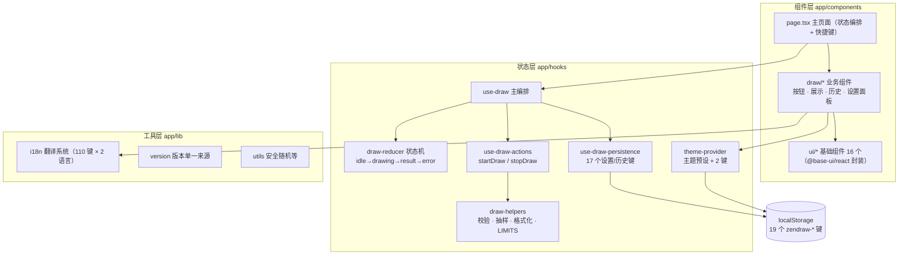
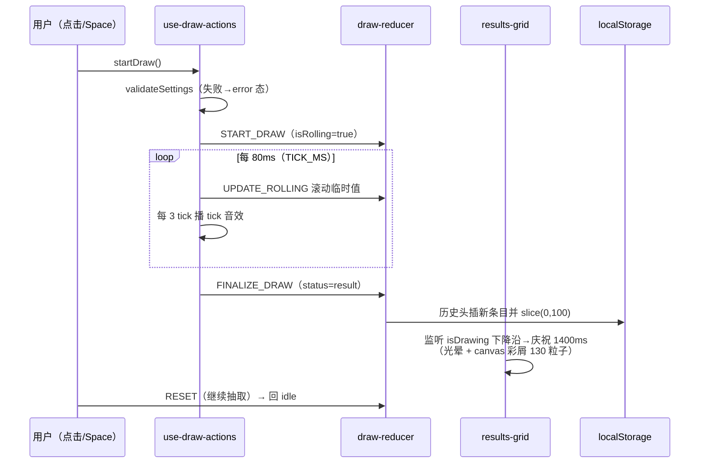

# ZenDraw | 禅抽 · 项目概述

> 适用版本：v5.7.14 ｜ 最后更新：2026-11-25 ｜ 维护人：WorkBuddy（AI 助手）
> 本文所有数字均为源码实算值；权威规范见 [openspec/SPEC.md](../openspec/SPEC.md)，术语以 SPEC §0.4 为准。

## 目录

1. [项目背景](#1-项目背景)
2. [项目目标](#2-项目目标)
3. [技术栈选型](#3-技术栈选型)
4. [架构设计](#4-架构设计)
5. [核心数据流](#5-核心数据流)
6. [设计原则](#6-设计原则)

## 1. 项目背景

ZenDraw（中文名「禅抽」）是一个**纯客户端**的抽签/抽取工具 Web 应用，解决三类高频场景：

- **数值抽取**：在指定范围内随机抽取 1–1000 个号码（如抽奖、点名、分配序号）；
- **名单抽取**：从自定义名单中随机抽取一个或多个成员（如课堂提问、活动分组）;
- **格式化输出**：对结果施加补零、前缀、后缀等格式（如生成编号 `NO.001`）。

产品定位强调「禅」的体验：克制的界面、可减弱的动效、零配置即用——打开页面即可完成一次抽取，所有偏好自动记住。

## 2. 项目目标

| 目标 | 度量现状（实算） |
|---|---|
| 零依赖后端、数据不出本地 | 无任何 HTTP API / Route Handler / Server Actions（源码零命中） |
| 快速可用 | 无需注册登录，打开即抽取 |
| 记住用户偏好 | 19 个 localStorage 键持久化全部设置与历史 |
| 可访问性 | 语义化 id + aria 属性 + 三层减弱动效支持 |
| 质量门禁 | tsc 0 错误、ESLint 0 警告、Vitest 7 文件 69/69 通过 |
| 国际化 | 简体中文（默认）与英文双语，110 个翻译键三处（types/zh/en）一致 |

## 3. 技术栈选型

| 技术 | 版本 | 选型理由 |
|---|---|---|
| Next.js | ^15.4.9 | App Router + 静态资源服务；本项目仅使用其客户端能力 |
| React | ^19.2.1 | 组件模型成熟，`useReducer` 承载核心状态机 |
| TypeScript | 5.9.3（精确锁定） | strict 模式；`TranslationKey` union 使 i18n 键完整性获得编译期保证 |
| Tailwind CSS | 4.1.11（精确锁定） | 原子化样式，配合 CSS 变量实现 11 套配色预设 |
| @base-ui/react | ^1.3.0 | 无样式基础组件库（Button/Slider/Switch/Sheet 等 16 个组件的底层） |
| motion（motion/react） | ^12.23.24 | 结果揭晓弹簧动画、列表 stagger；内置 `useReducedMotion` |
| next-themes | ^0.4.6 | light/dark/system 主题模式管理 |
| lucide-react | ^0.553.0 | 图标（统一 `aria-hidden` 处理） |
| Vitest + Testing Library | ^3.0.0 / ^16.0.0 | 单元测试（69 用例）+ 组件测试 |
| ESLint | 9.39.1（精确锁定） | 零告警门禁（`--max-warnings=0`），含 jsx-a11y / security / unused-imports 插件 |

**刻意不引入**：状态管理库（`useReducer` + Context 足够）、彩屑第三方库（自研 canvas 2D 粒子，130 粒子可控）、后端/数据库（数据全部留在浏览器 localStorage）。

## 4. 架构设计

纯客户端单页架构，三层单向依赖，`app/` 目录即全部运行时代码：

**关键架构决策**：

1. **单一状态机**：`DrawStatus = "idle" | "drawing" | "result" | "error"` 由 `draw-reducer.ts` 集中管理，UI 组件不持有抽取业务状态；
2. **设置字段单一登记处**：`SETTINGS_FIELDS` 常量 + 编译期穷尽守卫，杜绝字段列举漂移（`toSettings`/`initialSettings`/快照均由它派生）；
3. **安全随机**：抽样使用 `crypto.getRandomValues` 封装的 `secureRandomInt`（`utils.test.ts` 含 6000 次统计偏差检查），不用 `Math.random`；
4. **无服务端**：部署产物为纯静态资源 + Next 运行时，无数据库、无用户体系（详见 [api.md](api.md)）。

## 5. 核心数据流

## 6. 设计原则

- **无障碍优先**：`role="application"` 主容器、`aria-live` 结果播报（结果区 assertive / 历史 polite）、装饰元素 `aria-hidden`、三层减弱动效（系统偏好 / 用户设置 / 彩屑直接不渲染）；
- **持久化即契约**：每个 localStorage 键都有类型守卫（脏数据回退默认值而非白屏），对照表见 [api.md §3](api.md#3-持久化数据契约)；
- **文档-代码同源**：统计数字一律脚本实算，规范变更同步 SPEC §13 与 CHANGELOG（SPEC §0.5/§0.6）；
- **单文件 ≤200 行**：源码按职责拆分（文档文件除外）。

## 相关文档

| 文档 | 内容 |
|---|---|
| [deployment.md](deployment.md) | 环境依赖、安装步骤、多环境部署与验证 |
| [features.md](features.md) | 功能模块说明与业务流程图 |
| [api.md](api.md) | 接口契约（无服务端 API 声明 + 内部模块契约） |
| [user-guide.md](user-guide.md) | 用户操作指南与快捷键 |
| [faq.md](faq.md) | 常见问题与故障排除 |
| [optimization.md](optimization.md) | 优化建议与未来展望 |
