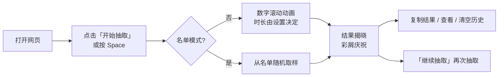

# ZenDraw | 禅抽 · 用户操作指南

> 适用版本：v5.7.14 ｜ 最后更新：2026-11-25 ｜ 维护人：WorkBuddy（AI 助手）

## 目录

1. [关于角色与权限](#1-关于角色与权限)
2. [快速上手](#2-快速上手)
3. [数字抽取](#3-数字抽取)
4. [名单抽取](#4-名单抽取)
5. [键盘快捷键](#5-键盘快捷键)
6. [设置面板](#6-设置面板)
7. [历史记录](#7-历史记录)
8. [数据存储与隐私](#8-数据存储与隐私)

## 1. 关于角色与权限

ZenDraw 是**单用户本地应用**：无账号体系、无登录、无服务端，因此**没有角色/权限划分**。所有功能对任意使用者开放；数据只保存在你自己的浏览器中，不同浏览器、不同设备之间互不相通。

如需区分使用场景，可参考两种「视角」：

- **普通使用者**：打开网页即可抽取，无需安装任何东西；
- **部署者**：按 [deployment.md](deployment.md) 自行部署一份实例给自己或团队使用（数据仍在各自浏览器本地）。

## 2. 快速上手

三步完成一次抽取：**设置范围（可选）→ 点击抽取 → 复制/使用结果**。所有设置自动记住，下次打开无需重配。

## 3. 数字抽取

1. 打开设置面板 →「抽取设置」Tab；
2. 设定**最小值**（默认 1）与**最大值**（默认 100）——范围跨度上限 10,000,000；
3. 用滑条设定**抽取数量**（1–1000 个，默认 1）；
4. 可选：关闭「允许重复」使结果不重复（默认允许）；
5. 可选：在「外观」Tab 设置补零位数（0–20，默认 3）、前缀、后缀——右侧有实时格式预览（如 `NO.007`）；
6. 回到主界面点击**「开始抽取」**；滚动时长可在「抽取设置」调整（1–30 秒，默认 5 秒）；
7. 动画结束后结果揭晓；点击「继续抽取」再次抽取。

## 4. 名单抽取

1. 设置面板 →「抽取设置」→ 打开**「启用名单」**开关；
2. 在内联编辑器中逐行输入成员（上限 1000 项）；名单支持**导出为文本**备份；
3. 点击抽取即从名单中随机取样，数量与「允许重复」设置同样生效；
4. 关闭开关即恢复数字模式。

## 5. 键盘快捷键

| 按键 | 生效条件 | 行为 |
|---|---|---|
| `Space` | 焦点不在输入框/按钮、面板未开启 | 按状态分流：空闲/结果态 → **开始抽取**；滚动中 → **提前停止**并立即出结果；结果态 → **继续抽取** |
| `Escape` | 设置面板开启 | 关闭面板 |
| `Enter` / `Space` | 焦点在开关（Switch）上 | 切换开关状态 |

> 快捷键设计为不干扰表单输入：光标在输入框内时 `Space` 正常输入空格，不会触发抽取。

## 6. 设置面板

点击主界面设置按钮打开（宽 420px），4 个 Tab：

- **抽取设置**：范围、数量、时长、允许重复、名单模式（见 §3/§4）；
- **外观**：主题模式（浅色/深色/跟随系统）、11 种配色预设（默认/海洋蓝/森林绿/落日橙/紫罗兰/霓虹/樱花粉/午夜蓝/复古棕/像素风/玫瑰红）、3 种字体（sans/mono/serif）、语言（中文/English）、补零与前后缀；
- **体验**：音效开关、彩屑开关、**减弱动效**（对动效敏感者建议开启，彩屑将完全不渲染）、自动隐藏面板、界面密度（舒适/紧凑）、**重置所有选项**（保留语言偏好）；
- **历史**：与主界面历史区相同（见 §7）。

## 7. 历史记录

- 每次抽取自动记录，**最近 100 条**（超出自动淘汰最旧的）；
- **复制**：点击任一历史卡片，结果以逗号分隔复制到剪贴板，并有 toast 提示；
- **清空**：历史区右上角清空按钮（不可恢复）；
- 每条记录含抽取时间，便于回溯。

## 8. 数据存储与隐私

- 全部数据（19 项设置与历史）仅存于**本浏览器 localStorage**，不上传任何服务器；
- 清除浏览器站点数据 / 无痕模式关闭 = 设置与历史全部丢失（建议重要名单用导出功能备份）；
- 跨标签页同步：同一浏览器多标签页间设置实时同步（storage 事件）；
- 无 Cookie、无埋点、无第三方追踪。
